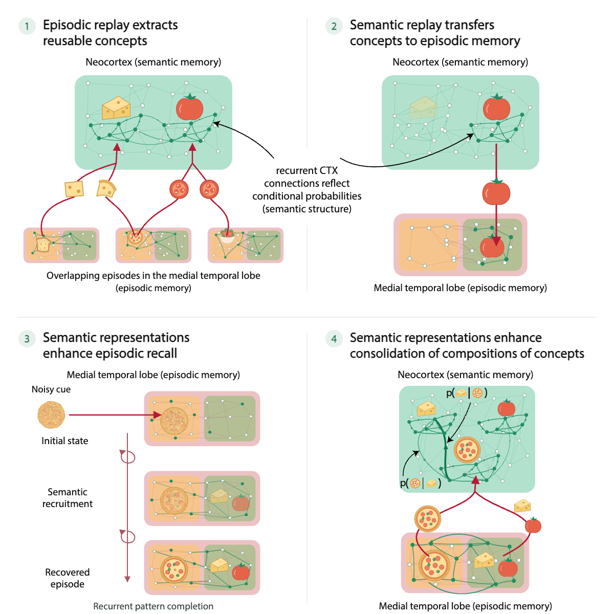

# sensory-semantic-episodes

This repository contains the code used to generate the analyses and figure panels for the manuscript:

**Albesa-González, Albert. & Clopath, Claudia. (2025).**  
**Learning a shared vocabulary between episodic and semantic memory enhances recall and compositional consolidation**



## Project structure

- `Figure_*.ipynb` notebooks reproduce the main figure panels and analyses from the manuscript.
- `Figure_*_utils.py` files provide the helper functions used by those notebooks.
- `src/model.py` contains the main sensory-semantic episodic memory model.
- `src/network_parameters.py` defines the model settings used across experiments.
- `src/utils/` contains shared plotting and general utility functions.

## Setup

Install the Python dependencies with:

```bash
pip install -r requirements.txt
```

After installation, run `python run_all_notebooks.py` from the repository root
to execute all notebooks in dependency order.

Large data files, checkpoints, and figure assets have been intentionally left out of the online repository and are available upon request.
